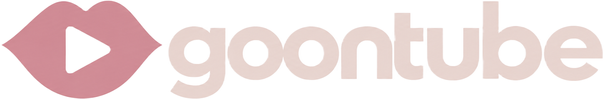

  

  <h1>Goontube</h1>
  
<strong>La vidéo, le partage et la communauté.</strong>

  
Une plateforme indépendante pour découvrir des vidéos, suivre des créateurs, partager ses contenus et échanger avec une communauté.

  

    <a href="https://goontube.fr"><strong>Visiter Goontube</strong></a>
    ·
    <a href="https://github.com/LJM191/Goontube-Official/issues">Signaler un problème</a>
  

  

    
    
    
  

---

## À propos

**Goontube** est une plateforme de partage de vidéos pensée autour de trois idées : la découverte, la création et les échanges.

Le projet rassemble dans une même interface un fil de vidéos, des pages de créateurs, des outils de publication et des espaces communautaires. L'objectif est de proposer une expérience simple et accessible, avec une identité visuelle qui lui est propre.

Le site est disponible à l'adresse **[goontube.fr](https://goontube.fr)**.

## Fonctionnalités

### Découvrir et regarder
- Fil d'accueil regroupant les vidéos publiques.
- Exploration et recherche de vidéos et de chaînes.
- Pages dédiées aux chaînes et aux créateurs.
- Lecteur vidéo avec commandes de lecture et affichage adapté aux différents écrans.
- Historique de visionnage et bibliothèque personnelle.

### Publier et gérer ses contenus
- Création d'un compte et d'une chaîne.
- Mise en ligne de vidéos avec titre, description et miniature.
- Génération d'une miniature à partir de la vidéo lorsque c'est possible.
- Compression vidéo côté navigateur lorsque cela est nécessaire.
- Choix de la visibilité d'une publication : publique, non répertoriée ou privée.

### Participer à la communauté
- Abonnement aux chaînes.
- Commentaires et interactions autour des vidéos.
- Espaces communautaires et forums publics.
- Publications dans les communautés, avec texte, images ou GIF.
- Votes sur les discussions.
- Notifications et gestion du profil.

> **À venir :** le flux de vidéos courtes (« Shorts ») est prévu, mais n'est pas encore disponible.

## Aperçu technique

Goontube est une application web construite avec React et TypeScript. TanStack Start et TanStack Router structurent l'application et sa navigation ; TanStack Query gère les données côté client.

Les services Supabase assurent notamment l'authentification, l'accès à la base de données et le stockage des médias. Le site est hébergé et déployé avec Netlify.

### Technologies

| Technologie | Utilisation |
| --- | --- |
| [React](https://react.dev/) | Interface utilisateur |
| [TypeScript](https://www.typescriptlang.org/) | Typage et développement |
| [TanStack Start](https://tanstack.com/start) | Framework applicatif |
| [TanStack Router](https://tanstack.com/router) | Navigation |
| [TanStack Query](https://tanstack.com/query) | Gestion des données |
| [Supabase](https://supabase.com/) | Authentification, base de données et stockage |
| [Tailwind CSS](https://tailwindcss.com/) | Styles et mise en page |
| [Netlify](https://www.netlify.com/) | Hébergement et déploiement |
| [Lucide](https://lucide.dev/) | Icônes |

### Fonctionnement général

<pre>
Visiteur ou membre
       |
       v
Application Goontube
       |
       v
Interface React / TypeScript
       |
       +------> Navigation et données
       |
       +------> Supabase
       |          +-- Authentification
       |          +-- Base de données
       |          +-- Stockage des médias
       |
       +------> Netlify (hébergement et déploiement)
</pre>

Ce schéma présente les grands composants du projet ; il ne représente pas chaque échange technique de l'application.

## Lancer le projet en local

### Prérequis

- [Git](https://git-scm.com/)
- [Bun](https://bun.sh/) (gestionnaire de paquets utilisé dans le workflow du projet)
- Un projet [Supabase](https://supabase.com/)

### Installation

Clone le dépôt, puis installe les dépendances :

<pre><code>git clone https://github.com/LJM191/Goontube-Official.git
cd Goontube-Official
bun install</code></pre>

Crée ensuite un fichier <code>.env</code> à la racine du projet à partir de <code>.env.example</code> :

<pre><code>VITE_SUPABASE_URL=
VITE_SUPABASE_PUBLISHABLE_KEY=</code></pre>

Renseigne les valeurs correspondant à ton propre projet Supabase. **Ne publie jamais de clé secrète ou de fichier <code>.env</code> contenant des identifiants.**

### Démarrer en développement

<pre><code>bun run dev</code></pre>

L'application est alors accessible à l'adresse locale indiquée par Vite dans le terminal.

### Vérifications disponibles

<pre><code>bun run build
bunx tsc --noEmit
bun run test
bun run lint</code></pre>

## Organisation du dépôt

Quelques répertoires importants :

| Chemin | Rôle |
| --- | --- |
| <code>src/routes/</code> | Pages et routes de l'application |
| <code>src/components/</code> | Composants réutilisables |
| <code>src/components/stream/</code> | Composants principaux de l'expérience vidéo |
| <code>src/lib/</code> | Logique applicative et utilitaires |
| <code>src/integrations/supabase/</code> | Intégration Supabase |
| <code>src/assets/</code> | Ressources graphiques, dont le logo |
| <code>supabase/</code> | Ressources liées à Supabase |

## Branches et développement

Le dépôt utilise deux branches principales :

- **<code>main</code>** : branche de référence pour la version stable.
- **<code>dev</code>** : branche de développement où sont préparées et vérifiées les évolutions.

Les changements doivent être développés sur <code>dev</code>, puis intégrés à <code>main</code> uniquement lorsqu'ils sont prêts et après validation.

Les workflows GitHub Actions permettent notamment de vérifier l'installation, la compilation, le typage TypeScript et les tests.

## Crédits

Goontube est un projet indépendant développé et maintenu par **[@LJM191](https://github.com/LJM191)**.

Merci aux équipes et communautés derrière les outils qui rendent ce projet possible :

- React et l'écosystème TanStack.
- Supabase pour les services backend.
- Netlify pour l'hébergement et le déploiement.
- Tailwind CSS pour les outils de style.
- Lucide pour les icônes.
- Toutes les personnes qui testent le site, signalent des problèmes et contribuent à son amélioration.

Les noms, marques et bibliothèques mentionnés appartiennent à leurs propriétaires respectifs. Leur citation ne signifie pas qu'ils sponsorisent ou approuvent Goontube.

## Contribuer et signaler un problème

Les retours et suggestions sont les bienvenus. Pour signaler un bug ou proposer une amélioration, ouvre une [issue sur GitHub](https://github.com/LJM191/Goontube-Official/issues) en décrivant clairement le problème ou l'idée.

Avant de proposer une modification, vérifie qu'elle est compatible avec l'organisation du projet et qu'elle ne compromet pas les fonctionnalités existantes.

## Licence

Aucun fichier de licence n'étant actuellement déclaré à la racine du dépôt, les conditions de réutilisation du code ne sont pas précisées ici. Ne considère pas le code comme librement réutilisable sans autorisation.

---

  <strong>Goontube — Découvrir. Créer. Partager.</strong> 
  <a href="https://goontube.fr">goontube.fr</a>

